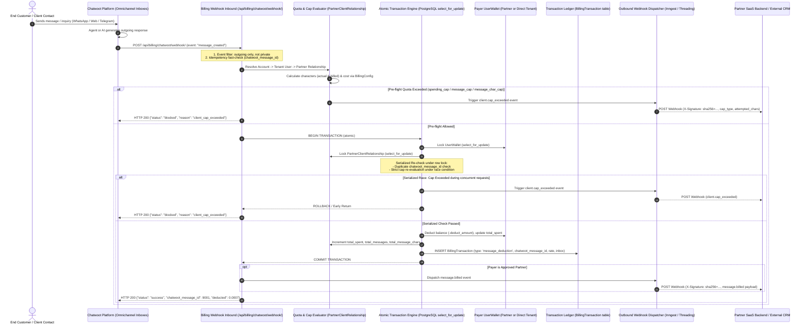

# Omnichannel Per-Character Chatwoot Billing & Partner Retail Quota System
# نظام فوترة رسائل شات ووت بالحرف والتسعير بالتجزئة وإدارة حصص الشركاء

> **Status**: Production Ready & Fully Tested (100% E2E Concurrency & Multi-language Verification)  
> **الحالة**: جاهز للإنتاج ومختبر بالكامل (اجتياز 100% لاختبارات التزامن ودعم اللغات الست)  
> **Component Repositories**: `voice-ai-telephony` (Django backend & Celery/Inngest workers) & `ai-native` (Go/FreeSWITCH telephony & unified billing design)  
> **Supported Languages**: Arabic (`ar`), English (`en`), Turkish (`tr`), French (`fr`), German (`de`), Spanish (`es`)

---

## Table of Contents / جدول المحتويات

1. [Architecture & Executive Summary / الملخص المعماري والتنفيذي](#1-architecture--executive-summary--الملخص-المعماري-والتنفيذي)
   - [Executive Overview (English)](#11-executive-overview)
   - [نظرة عامة تنفيذية (العربية)](#12-نظرة-عامة-تنفيذية)
   - [Complete End-to-End Mermaid Sequence Diagram](#13-complete-end-to-end-event-flow-diagram)
2. [Pricing Mechanics & Character Formulas / معادلات وطريقة التسعير بالحرف](#2-pricing-mechanics--character-formulas--معادلات-وطريقة-التسعير-بالحرف)
   - [Mathematical Model & Variables](#21-mathematical-model--configuration-variables)
   - [معادلات التسعير والحدود الدنيا والمرفقات](#22-معادلات-التسعير-والحدود-الدنيا-والمرفقات)
   - [Real-World Numerical Calculation Examples](#23-real-world-numerical-calculation-examples)
3. [Partner Retail Markup & Profit Model / نموذج تسعير وأرباح الشركاء](#3-partner-retail-markup--profit-model--نموذج-تسعير-وأرباح-الشركاء)
   - [Wholesale vs. Retail Dual-Pricing Engine](#31-wholesale-vs-retail-dual-pricing-engine)
   - [معادلات الربح وإيرادات التجزئة](#32-معادلات-الربح-وإيرادات-التجزئة)
   - [Partner Dashboard KPI Aggregations](#33-partner-dashboard-kpi-aggregations)
4. [Client Quotas & Cap Enforcement / أسقف وحصص الاستهلاك للعملاء](#4-client-quotas--cap-enforcement--أسقف-وحصص-الاستهلاك-للعملاء)
   - [The Four Strict Consumption Caps](#41-the-four-strict-consumption-caps)
   - [شرح الأسقف الأربعة وطريقة حماية الرصيد](#42-شرح-الأسقف-الأربعة-وطريقة-حماية-الرصيد)
   - [Two-Phase Concurrency Enforcement & Blocking Lifecycle](#43-two-phase-concurrency-enforcement--blocking-lifecycle)
5. [API Reference & Webhook JSON Specifications / مرجع الـ APIs وعقود الـ Webhooks](#5-api-reference--webhook-json-specifications--مرجع-الـ-apis-وعقود-الـ-webhooks)
   - [Partner Settings API (`GET` & `POST` `/api/partner/v1/settings/`)](#51-partner-settings-api)
   - [Client Quota Management API (`GET` & `POST` `/api/partner/v1/clients/<client_id>/quota/`)](#52-client-quota-management-api)
   - [Chatwoot Inbound Webhook Payload (`message_created`)](#53-chatwoot-inbound-webhook-payload)
   - [Partner Outbound Webhook Payloads (`client.cap_exceeded` & `message.billed`)](#54-partner-outbound-webhook-payloads)
6. [Operations, Administration & Maintenance / التشغيل والإدارة والصيانة](#6-operations-administration--maintenance--التشغيل-والإدارة-والصيانة)
   - [Django Admin Portals & Live Inspection](#61-django-admin-portals--live-inspection)
   - [Management Commands & Webhook Self-Healing](#62-management-commands--webhook-self-healing)
   - [Automated Tenant Provisioning Pipeline](#63-automated-tenant-provisioning-pipeline)
   - [Internationalization (i18n) Engine Architecture](#64-internationalization-i18n-engine-architecture)

---

## 1. Architecture & Executive Summary / الملخص المعماري والتنفيذي

### 1.1 Executive Overview

The **Omnichannel Chatwoot Per-Character Billing System** and the **Partner Retail Markup & Quota Management Engine** form an enterprise-grade financial infrastructure for voice and digital customer communications. Traditional platforms charge a flat rate per message or require clumsy manual prepaid top-ups. In contrast, this system introduces:

1. **Exact Micro-Billing by Character Count**: Messages across WhatsApp, Web Chat, Telegram, Facebook Messenger, and SMS are parsed dynamically. Outgoing agent or AI responses are billed per 1,000 characters with a configurable baseline minimum floor and media attachment equivalencies.
2. **Two-Tier Reseller SaaS Model (Wholesale vs. Retail)**:
   - **Platform-to-Partner (Wholesale)**: Approved SaaS partners obtain volume discounts (`custom_rate_per_minute` and `custom_rate_per_1k_chars`). Sub-client usage is deducted directly from the partner's central master wallet.
   - **Partner-to-Client (Retail)**: Partners configure their own markup prices (`retail_rate_per_minute` and `retail_rate_per_1k_chars`). The platform tracks client consumption, calculates gross client billing, and projects the partner's net profit margin in real time.
3. **Four-Dimensional Client Quota Caps**: Partners can assign granular limits to each sub-client:
   - `spending_cap` (Dollar cost limit)
   - `minute_cap` (Voice duration limit)
   - `message_cap` (Outgoing message count limit)
   - `message_char_cap` (Total character volume limit)
4. **Guaranteed Concurrency Safety & Automated Webhook Dispatch**: Double-layer database row locking (`select_for_update`) prevents duplicate billing during high-volume spikes. Out-of-quota attempts trigger instantaneous HTTP 200 rejections and dispatch signed HMAC-SHA256 `client.cap_exceeded` webhooks to the partner's core backend.

---

### 1.2 نظرة عامة تنفيذية

يمثل **نظام فوترة رسائل شات ووت بالحرف (Per-Character Omnichannel Billing)** ونظام **هوامش أرباح التجزئة وحصص الشركاء (Partner Retail Markup & Client Quotas)** بنية تحتية مالية متكاملة لخدمات الذكاء الاصطناعي الصوتي والمحادثات الرقمية الموحدة (Omnichannel).

على عكس الأنظمة التقليدية التي تفرض سعراً ثابتاً غير عادل لكل رسالة (مما يظلم العميل في الرسائل القصيرة مثل "نعم" أو يسبب خسارة للشركة في الرسائل الطويلة المحملة بالبيانات)، يوفر هذا النظام:
1. **تسعير مالي دقيق بالحرف**: يتم احتساب تكلفة كل رسالة صادرة من موظفي خدمة العملاء أو البوتات الذكية عبر قنوات واتساب، الدردشة الحية، وتيليجرام بناءً على عدد الحروف الفعلي لكل 1000 حرف مع وضع حد أدنى لحماية تكاليف معالجة الشبكة واحتساب مكافئ للوسائط والمرفقات.
2. **نموذج بيع ثنائي الطبقات لشركاء الساس (الجملة مقابل التجزئة)**:
   - **سعر الجملة (Wholesale)**: يحصل الشريك المعتمد على أسعار مخفضة للدقيقة وللألف حرف تُخصم من محفظته المركزية تلقائياً عند استهلاك عملائه.
   - **سعر التجزئة (Retail)**: يحدد الشريك أسعار البيع الخاصة به لعملائه النهائيين، ويقوم النظام آلياً باحتساب الإيراد المتوقع وإجمالي الأرباح الصافية للشريك في لوحة التحكم.
3. **أربعة أسقف رقابية لحصص العملاء (Client Quota Caps)**:
   - سقف التكلفة الإجمالية بالدولار (`spending_cap`).
   - سقف الدقائق الصوتية (`minute_cap`).
   - سقف عدد الرسائل الصادرة (`message_cap`).
   - سقف إجمالي الحروف المستهلكة (`message_char_cap`).
4. **حماية التزامن والإشعار الفوري بالويب هوك**: يعتمد النظام على إقفال القيود بقاعدة البيانات (`select_for_update`) لمنع الخصم المزدوج أثناء ورود مئات الرسائل في اللحظة نفسها. وعند تجاوز العميل لأي من أسقفه، يتم حظر الرسالة فوراً دون استهلاك رصيد الشريك، وتوجيه تنبيه موقع بتشفير HMAC-SHA256 إلى نظام الشريك البرمجي.

---

### 1.3 Complete End-to-End Event Flow Diagram



---

## 2. Pricing Mechanics & Character Formulas / معادلات وطريقة التسعير بالحرف

### 2.1 Mathematical Model & Configuration Variables

The billing engine resides in `billing.models.BillingConfig`. It is a singleton record accessible via `BillingConfig.get_config()`.

| Variable Name | DB Type | Default Value | Description (English) | الوصف (العربية) |
|---|---|---|---|---|
| `cost_per_1k_chars` | `Decimal(10,4)` | `0.0100` ($) | Platform baseline charge per 1,000 characters | سعر الفوترة الأساسي لكل 1,000 حرف |
| `min_chars_per_message` | `PositiveInt` | `50` chars | Minimum billed character floor per outgoing message | الحد الأدنى لاحتساب الحروف لأي رسالة صادرة |
| `media_equivalent_chars`| `PositiveInt` | `500` chars | Characters charged for media attachments with no text | عدد الحروف المحتسب للرسائل ذات المرفقات دون نص |
| `cost_per_minute` | `Decimal(10,4)` | `0.0500` ($) | Platform voice call minute cost (ceiling rounded) | سعر الدقيقة الصوتية العادية للنظام |

### 2.2 معادلات التسعير والحدود الدنيا والمرفقات

تُحسب الحروف والتكلفة طبقاً للمعادلات الخوارزمية التالية:

```python
# 1. حساب عدد الحروف الفعلي
if content and content.strip():
    actual_chars = len(content.strip())
elif has_media:
    actual_chars = config.media_equivalent_chars
else:
    actual_chars = 0

# 2. تطبيق الحد الأدنى لحماية المعالجة
if actual_chars > 0 or has_media:
    billed_chars = max(actual_chars, config.min_chars_per_message)
else:
    billed_chars = 0

# 3. احتساب التكلفة المالية بالتقريب لـ 4 خانات عشرية
if billed_chars > 0:
    cost = round((Decimal(str(billed_chars)) / Decimal("1000")) * rate_applied, 4)
else:
    cost = Decimal("0.0000")
```

- **رسائل المحادثة الفارغة**: إذا لم تحتوِ الرسالة على أي نص أو وسائط، يتم تجاهلها فوراً دون تسجيل حركة مالية (`status: "ignored", reason: "empty_message"`).
- **الرسائل الواردة والملاحظات الخاصة**: الرسائل الواردة من العملاء (`incoming`) أو الملاحظات الداخلية للموظفين (`private: true`) **مجانية تماماً** ولا يُفرض عليها أي خصم مالي.

---

### 2.3 Real-World Numerical Calculation Examples

لتوضيح الحسابات في بيئة الإنتاج الحقيقية، نورد السيناريوهات التالية بافتراض السعر الافتراضي العام (`0.0100$ / 1,000 حرف`):

#### المثال الأول: رسالة نصية قصيرة (أقل من الحد الأدنى)
- **محتوى الرسالة**: `"أهلاً بك، تم استلام طلبك"` (27 حرفاً).
- **الحروف الفعلية (`actual_chars`)**: `27`
- **الحروف المحتسبة (`billed_chars`)**: `max(27, 50) = 50`
- **التكلفة (`cost`)**:
  $$\text{Cost} = \left(\frac{50}{1000}\right) \times 0.0100 = 0.0005\,\text{USD}$$
- **البيان بالجدول**: خصم مالي متناهي الصغر بمقدار `$0.0005`.

#### المثال الثاني: رسالة تفصيلية طويلة (أكبر من الحد الأدنى)
- **محتوى الرسالة**: إرسال تفاصيل فاتورة وخطوات الاشتراك عبر واتساب (1,500 حرف).
- **الحروف الفعلية (`actual_chars`)**: `1500`
- **الحروف المحتسبة (`billed_chars`)**: `max(1500, 50) = 1500`
- **التكلفة (`cost`)**:
  $$\text{Cost} = \left(\frac{1500}{1000}\right) \times 0.0100 = 0.0150\,\text{USD}$$

#### المثال الثالث: مرفق وسائط بدون نص (Media Attachment / PDF / صورة)
- **محتوى الرسالة**: ملف PDF لدليل الاستخدام أو صورة منتج مرسلة للعميل دون كتابة نصية مصاحبة (`content = ""`, `attachments = [pdf]`).
- **الحروف الفعلية (`actual_chars`)**: مكافئ الميديا = `500` حرف.
- **الحروف المحتسبة (`billed_chars`)**: `max(500, 50) = 500`
- **التكلفة (`cost`)**:
  $$\text{Cost} = \left(\frac{500}{1000}\right) \times 0.0100 = 0.0050\,\text{USD}$$

#### المثال الرابع: مرفق وسائط مع نص
- **محتوى الرسالة**: صورة ملحقة بعبارة `"إليك الإيصال"` (12 حرفاً).
- **الحروف الفعلية (`actual_chars`)**: `12`
- **الحروف المحتسبة (`billed_chars`)**: `max(12, 50) = 50`
- **التكلفة (`cost`)**:
  $$\text{Cost} = \left(\frac{50}{1000}\right) \times 0.0100 = 0.0005\,\text{USD}$$

---

## 3. Partner Retail Markup & Profit Model / نموذج تسعير وأرباح الشركاء

### 3.1 Wholesale vs. Retail Dual-Pricing Engine

يدعم النظام نموذج شركاء الساس (SaaS Resellers / White-Label Partners). لكل شريك ملف مسجل في جدول `PartnerProfile`:

```
┌────────────────────────────────────────────────────────────────────────┐
│                        PLATFORM CORE SYSTEM                            │
└──────────────────────────────────┬─────────────────────────────────────┘
                                   │ Wholesale Rate ($0.0070 / 1k chars)
                                   ▼
┌────────────────────────────────────────────────────────────────────────┐
│                        PARTNER SAAS MASTER                             │
│   • Wallet Balance: $100.00                                            │
│   • Custom Wholesale Rate: $0.0070 / 1k chars | $0.0300 / voice min    │
│   • Configured Retail Rate: $0.0150 / 1k chars | $0.0500 / voice min   │
└──────────────────────────────────┬─────────────────────────────────────┘
                                   │ Retail Billing ($0.0150 / 1k chars)
                                   ▼
┌────────────────────────────────────────────────────────────────────────┐
│                       SUB-CLIENT (TENANT END-USER)                     │
│   • Sends 100,000 characters                                           │
│   • Wholesale Cost to Partner: $0.70                                   │
│   • Retail Revenue Billed to Client: $1.50                             │
│   • Partner Net Estimated Profit: +$0.80                               │
└────────────────────────────────────────────────────────────────────────┘
```

1. **سعر الجملة المخفض للشريك (Wholesale Rates)**:
   - `custom_rate_per_minute` (افتراضياً: `0.0300$` للدقيقة بدلاً من `0.0500$`).
   - `custom_rate_per_1k_chars` (افتراضياً: `0.0070$` لكل ألف حرف بدلاً من `0.0100$`).
   - هذا هو السعر الذي يخصمه النظام المركزي من محفظة الشريك (`UserWallet`).
2. **سعر التجزئة المحدد للعملاء (Retail Rates)**:
   - `retail_rate_per_minute` (افتراضياً: `0.0500$` للدقيقة).
   - `retail_rate_per_1k_chars` (افتراضياً: `0.0150$` لكل ألف حرف).
   - هذا هو السعر الذي يفرضه الشريك على عملائه النهائيين لحساب الفواتير والأرباح.

---

### 3.2 معادلات الربح وإيرادات التجزئة

يتم حساب أرباح الشريك على مستوى كل عميل (`PartnerClientRelationship`) أو على مستوى إجمالي أعمال الشريك عبر الخصائص الرياضية التالية:

$$\text{Minute Revenue} = \text{total\_minutes} \times \text{retail\_rate\_per\_minute}$$

$$\text{Message Revenue} = \left(\frac{\text{total\_message\_chars}}{1000}\right) \times \text{retail\_rate\_per\_1k\_chars}$$

$$\text{Total Retail Revenue} = \text{round}(\text{Minute Revenue} + \text{Message Revenue},\, 4)$$

$$\text{Estimated Profit} = \text{round}(\text{Total Retail Revenue} - \text{total\_spent},\, 4)$$

حيث يمثل `total_spent` إجمالي المبالغ الفعلية التي خُصمت بالجملة من محفظة الشريك لصالح هذا العميل.

---

### 3.3 Partner Dashboard KPI Aggregations

تُعرض المؤشرات المالية في واجهة الشريك (`GET /api/partner/v1/dashboard/`) بشكل لحظي:

```json
{
  "status": "success",
  "kpis": {
    "total_clients": 15,
    "total_minutes": 1420,
    "total_sub_spent": 42.6000,
    "custom_rate": 0.0300,
    "custom_rate_per_1k_chars": 0.0070,
    "retail_rate_per_minute": 0.0500,
    "retail_rate_per_1k_chars": 0.0150,
    "total_retail_revenue": 76.2500,
    "total_estimated_profit": 33.6500
  }
}
```

---

## 4. Client Quotas & Cap Enforcement / أسقف وحصص الاستهلاك للعملاء

### 4.1 The Four Strict Consumption Caps

لكل عميل تابع لشريك (`PartnerClientRelationship`) أربعة أسقف مستقلة للتحكم في استهلاكه ومنع استنزاف رصيد الشريك:

| Cap Field Name | Data Type | Nullable | Description (English) | الوصف وسلوك الحظر (العربية) |
|---|---|---|---|---|
| `spending_cap` | `Decimal(10,2)` | Yes (`null` = لا سقف) | Maximum allowable total wholesale dollars | سقف التكلفة الإجمالية بالدولار المسموح بها للعميل |
| `minute_cap` | `PositiveInt` | Yes (`null` = لا سقف) | Maximum allowable billed voice minutes | الحد الأقصى لإجمالي الدقائق الصوتية المستهلكة |
| `message_cap` | `PositiveInt` | Yes (`null` = لا سقف) | Maximum allowable outgoing message count | الحد الأقصى لعدد الرسائل الصادرة للعميل |
| `message_char_cap` | `PositiveInt` | Yes (`null` = لا سقف) | Maximum allowable cumulative message characters | الحد الأقصى لإجمالي الحروف المحتسبة لرسائل العميل |
| `is_active` | `Boolean` | No (default `True`) | Master kill-switch toggle for calling & messaging | مفتاح الإيقاف/التشغيل الفوري للعميل دون حذف الأسقف |

---

### 4.2 شرح الأسقف الأربعة وطريقة حماية الرصيد

تعتمد نماذج الذكاء الاصطناعي والمحادثات على وتيرة متسارعة؛ لذا يوفر النظام فحصاً دقيقاً يسبق أي خصم:

1. **فحص سقف التكلفة (`spending_cap`)**:
   يتم التحقق من أن:
   $$\text{total\_spent} + \text{next\_cost} \le \text{spending\_cap}$$
   إذا تجاوزت الرسالة أو المكالمة السقف، يتم حظرها فوراً بنوع سقف `spending_cap`.
2. **فحص سقف عدد الرسائل (`message_cap`)**:
   يتم التحقق من أن:
   $$\text{total\_messages} + 1 \le \text{message\_cap}$$
   إذا كان العميل قد استهلك حصته المحددة من الرسائل، تُحظر الرسالة بنوع سقف `message_cap`.
3. **فحص سقف الحروف (`message_char_cap`)**:
   يتم التحقق من أن:
   $$\text{total\_message\_chars} + \text{billed\_chars} \le \text{message\_char_cap}$$
   إذا كانت الرسالة القادمة ستتسبب في تجاوز عدد الحروف التراكمي المسموح به، تُحظر بنوع سقف `message_char_cap`.
4. **فحص سقف الدقائق للمكالمات (`minute_cap`)**:
   يتم التحقق قبل وأثناء المكالمة من عدم تجاوز الدقائق التراكمية، وفي حال الوصول للحد يتم إنهاء المكالمة أو منع إنشائها.

---

### 4.3 Two-Phase Concurrency Enforcement & Blocking Lifecycle

لتفادي مشاكل تسابق البيانات (Race Conditions) عند ورود عشرات الرسائل المتزامنة عبر الـ Webhook:

1. **المرحلة الأولى: الفحص المسبق السريع (Pre-Flight Optimistic Check)**:
   يتم استدعاء `partner_rel.is_message_cap_exceeded(next_chars, next_cost)` قبل الدخول في معاملات قاعدة البيانات المعقدة لتخفيف الحمل وسرعة الاستجابة.
2. **المرحلة الثانية: الفحص الحصري المقفل (Serialized Lock Re-Check)**:
   داخل معاملة `transaction.atomic()`:
   ```python
   locked_rel = PartnerClientRelationship.objects.select_for_update().filter(id=partner_rel.id).first()
   if locked_rel.is_message_cap_exceeded(next_chars=billed_chars, next_cost=cost_dec):
       cap_type = locked_rel.get_exceeded_message_cap_type(next_chars=billed_chars, next_cost=cost_dec)
       _dispatch_cap_exceeded_webhook(partner, locked_rel, tenant_user, cap_type, billed_chars, cost_dec, msg_id)
       return JsonResponse({"status": "blocked", "reason": "client_cap_exceeded", "cap_type": cap_type})
   ```
   هذا يضمن استحالة تجاوز السقف حتى لو أرسل العميل 100 رسالة في الجزء نفسه من الثانية.
3. **إشعار الويب هوك التلقائي (`client.cap_exceeded`)**:
   عند الحظر، يرسل النظام إشعار Webhook فورياً لنظام الشريك يحمل كافة تفاصيل المحاولة وسبب الحظر دون خصم أي سنت.

---

## 5. API Reference & Webhook JSON Specifications / مرجع الـ APIs وعقود الـ Webhooks

### 5.1 Partner Settings API

يسمح هذا الرابط للشريك بقراءة وتعديل أسعار التجزئة الخاصة به ورابط الـ Webhook الخاص بنظامه.

#### Endpoint
- **URL**: `/api/partner/v1/settings/`
- **Methods**: `GET`, `POST`
- **Headers**:
  ```http
  X-Partner-Key: sk_live_prt_XXXXXXXXXXXXXXXXXXXXXXXX
  Content-Type: application/json
  ```
  *(يدعم أيضاً التوثيق عبر `Authorization: Bearer <key>` أو جلسة تسجيل الدخول).*

#### Request Body (`POST`)
```json
{
  "retail_rate_per_minute": 0.0550,
  "retail_rate_per_1k_chars": 0.0160,
  "webhook_url": "https://partner-saas.com/api/webhooks/voice-events/",
  "shared_mcp_server_id": 4
}
```

#### Response (`200 OK`)
```json
{
  "status": "success",
  "message": "تم حفظ إعدادات الشريك بنجاح.",
  "settings": {
    "company_name": "CloudReseller Corp",
    "partner_code": "PRT-8F2B1C",
    "custom_rate_per_minute": 0.0300,
    "custom_rate_per_1k_chars": 0.0070,
    "retail_rate_per_minute": 0.0550,
    "retail_rate_per_1k_chars": 0.0160,
    "currency": "USD",
    "webhook_url": "https://partner-saas.com/api/webhooks/voice-events/",
    "has_webhook_secret": true,
    "shared_mcp_server_id": 4
  }
}
```

---

### 5.2 Client Quota Management API

يسمح بقراءة وتعديل أسقف الاستهلاك الأربعة لأي عميل تابع للشريك.

#### Endpoints
- `GET /api/partner/v1/clients/<client_id>/quota/`
- `POST /api/partner/v1/clients/<client_id>/quota/`
- *(متاح أيضاً عبر مسار الـ Alias التوافقي: `/api/partner/v1/clients/<client_id>/cap/`)*

> **ملاحظة**: يقبل المسار إما المعرف الداخلي للنظام `client_id` أو المعرف الخارجي التابع لنظام الشريك `external_reference`.

#### Request Body (`POST`)
```json
{
  "spending_cap": 50.00,
  "minute_cap": 300,
  "message_cap": 1000,
  "message_char_cap": 150000,
  "is_active": true
}
```
*ملاحظة: لإلغاء أي سقف وجعله غير محدود، قم بإرسال القيمة كـ `null` أو نص فارغ `""`.*

#### Response (`200 OK`)
```json
{
  "status": "success",
  "message": "تم تحديث سقف العميل بنجاح.",
  "client": {
    "id": 142,
    "client_id": 1849,
    "username": "client_acme_corp",
    "name": "Acme Real Estate",
    "email": "contact@acme.com",
    "external_reference": "CRM-CLIENT-991",
    "spending_cap": 50.0,
    "minute_cap": 300,
    "message_cap": 1000,
    "message_char_cap": 150000,
    "total_spent": 12.4500,
    "total_minutes": 115,
    "total_messages": 420,
    "total_message_chars": 34100,
    "retail_revenue": 21.2060,
    "estimated_profit": 8.7560,
    "is_active": true,
    "created_at": "2026-11-10 14:30"
  }
}
```

---

### 5.3 Chatwoot Inbound Webhook Payload

البيانات المرسلة من منصة شات ووت إلى المسار الداخلي للنظام:
- **URL**: `POST /api/billing/chatwoot/webhook/`

```json
{
  "event": "message_created",
  "id": 84920,
  "message_type": "outgoing",
  "private": false,
  "content": "مرحباً بك! يسعدنا إبلاغك بأن طلبك رقم #1024 قد تم شحنه بنجاح وسيصلك غداً.",
  "attachments": [],
  "account": {
    "id": 12,
    "name": "Acme Customer Care"
  },
  "inbox": {
    "id": 5,
    "name": "WhatsApp Official Channel"
  },
  "conversation": {
    "id": 3120
  }
}
```

#### ردود المعالجة القياسية:
- **تم الخصم بنجاح (`200 OK`)**:
  ```json
  {
    "status": "success",
    "chatwoot_message_id": 84920,
    "actual_characters": 76,
    "billed_characters": 76,
    "rate_applied": 0.0070,
    "cost": 0.0005,
    "deducted": 0.0005,
    "balance_after": 99.9995,
    "transaction_id": 38104
  }
  ```
- **حظر لتجاوز السقف (`200 OK`)**:
  ```json
  {
    "status": "blocked",
    "reason": "client_cap_exceeded",
    "client_id": 1849,
    "cap_type": "message_char_cap"
  }
  ```
- **تكرار الرسالة / Idempotency (`200 OK`)**:
  ```json
  {
    "status": "ignored",
    "reason": "already_billed",
    "chatwoot_message_id": 84920
  }
  ```

---

### 5.4 Partner Outbound Webhook Payloads

تُرسل هذه الـ Webhooks إلى رابط الشريك المسجل (`webhook_url`) وتُوقع بـ HMAC-SHA256 في ترويسة `X-Signature`.

#### ترويسات الطلب الصادر:
```http
POST /api/voice-events/ HTTP/1.1
Host: partner-saas.com
Content-Type: application/json
X-Signature: sha256=4f2a1b9c8d7e6f5a4b3c2d1e0f9a8b7c6d5e4f3a2b1c0d9e8f7a6b5c4d3e2f1a
User-Agent: Voice-AI-Partner-Platform/1.0
```

#### الحدث الأول: `client.cap_exceeded` (تجاوز سقف الاستهلاك)
يُرسل هذا الحدث فوراً عند حظر أي رسالة أو مكالمة بسبب نفاد الحصة:

```json
{
  "event": "client.cap_exceeded",
  "partner_code": "PRT-8F2B1C",
  "timestamp": "2026-11-11T18:40:00Z",
  "data": {
    "client_id": 1849,
    "client_name": "Acme Real Estate",
    "username": "client_acme_corp",
    "external_reference": "CRM-CLIENT-991",
    "cap_type": "message_cap",
    "spending_cap": 50.0,
    "minute_cap": 300,
    "message_cap": 1000,
    "message_char_cap": 150000,
    "total_spent": 49.8000,
    "total_minutes": 290,
    "total_messages": 1000,
    "total_message_chars": 124500,
    "attempted_chars": 120,
    "attempted_cost": 0.0008,
    "chatwoot_message_id": 84931
  }
}
```

#### الحدث الثاني: `message.billed` (تمت فوترة رسالة بنجاح)
يُرسل هذا الحدث عند نجاح خصم الرسالة من محفظة الشريك لتحديث سجلات الـ CRM لديه:

```json
{
  "event": "message.billed",
  "partner_code": "PRT-8F2B1C",
  "timestamp": "2026-11-11T18:41:15Z",
  "data": {
    "client_id": 1849,
    "client_name": "Acme Real Estate",
    "external_reference": "CRM-CLIENT-991",
    "chatwoot_message_id": 84932,
    "inbox_name": "WhatsApp Official Channel",
    "actual_characters": 85,
    "billed_characters": 85,
    "cost": 0.0006,
    "deducted_amount": 0.0006,
    "rate_applied": 0.0070,
    "partner_remaining_balance": 99.4120,
    "insufficient_balance": false
  }
}
```

---

## 6. Operations, Administration & Maintenance / التشغيل والإدارة والصيانة

### 6.1 Django Admin Portals & Live Inspection

يوفر نظام إدارة جانجو (`/admin/`) واجهات تحكم ومراقبة لحظية:

1. **إعدادات الفوترة (`BillingConfig Admin`)**:
   - تعديل سعر الألف حرف (`cost_per_1k_chars`).
   - تعديل الحد الأدنى للحروف (`min_chars_per_message`).
   - تعديل مكافئ الميديا (`media_equivalent_chars`).
   - تعيين الرصيد الترحيبي المجاني والعملة.
2. **ملفات الشركاء (`PartnerProfile Admin`)**:
   - اعتماد الشركاء الجدد أو تعليقهم (`pending`, `approved`, `suspended`).
   - تخصيص أسعار الجملة لكل شريك على حدة.
   - تحديد أسعار التجزئة الافتراضية للعملاء.
   - إعادة توليد مفاتيح الـ API ومفاتيح التوقيع للـ Webhook.
3. **علاقات عملاء الشركاء (`PartnerClientRelationship Admin`)**:
   - عرض قائمة عملاء كل شريك.
   - ضبط ومراجعة الأسقف الأربعة (`spending_cap`, `minute_cap`, `message_cap`, `message_char_cap`).
   - الإيقاف أو التفعيل السريع للعميل.
4. **سجل الحركات المالية (`BillingTransaction Admin`)**:
   - تصفية الحركات بنوع `message_deduction`.
   - البحث برقم رسالة شات ووت `chatwoot_message_id`.
   - فحص اسم صندوق الوارد `inbox_name`، والحروف الفعلية والمحتسبة.

---

### 6.2 Management Commands & Webhook Self-Healing

لضمان تسجيل الـ Webhooks في جميع حسابات شات ووت الحالية والجديدة دون تدخل يدوي، تم تزويد النظام بأمر إدارة ذاتي الإصلاح:

```bash
# تشغيل الأمر لتسجيل الـ Webhooks لجميع الحسابات في قاعدة بيانات Chatwoot
python manage.py register_chatwoot_webhooks

# تحديد عنوان مخصص للـ Webhook (اختياري)
python manage.py register_chatwoot_webhooks --url http://voice_django:8000/api/billing/chatwoot/webhook/
```

يقوم هذا الأمر بفتح اتصال مباشر مع قاعدة بيانات Chatwoot وتنفيذ استعلام `INSERT ... ON CONFLICT (account_id, url) DO UPDATE` لتسجيل الاشتراك في أحداث `["message_created"]`.

---

### 6.3 Automated Tenant Provisioning Pipeline

في دالة `get_or_create_tenant_chatwoot(user)` ضمن `chatwoot_service.py`:
- عند تسجيل أو دخول أي مستأجر (Tenant) جديد، يقوم النظام تلقائياً بإنشاء:
  1. حساب Chatwoot مستقل (`Account`).
  2. مستخدم مميز (`User`).
  3. مساعد ذكاء اصطناعي (`Captain Assistant`).
  4. **تسجيل Webhook الفوترة آلياً** في المعاملة نفسها لضمان عدم ضياع أي رسالة صادرة دون احتساب.

---

### 6.4 Internationalization (i18n) Engine Architecture

تمت ترجمة كافة الحقول والمدخلات والجداول ولوحات التحكم بنسبة 100% عبر 6 لغات عالمية:

| الرمز (Code) | اللغة (Language) | اتجاه النص (Direction) | ملفات الترجمة الرئيسية |
|---|---|---|---|
| `ar` | العربية (Arabic) | RTL | `static/js/common.js`, `templates/voice_assistant/pages/partner.html` |
| `en` | English | LTR | `static/js/common.js`, `templates/voice_assistant/pages/partner.html` |
| `tr` | Türkçe (Turkish) | LTR | `static/js/common.js`, `templates/voice_assistant/pages/partner.html` |
| `fr` | Français (French) | LTR | `static/js/common.js`, `templates/voice_assistant/pages/partner.html` |
| `de` | Deutsch (German) | LTR | `static/js/common.js`, `templates/voice_assistant/pages/partner.html` |
| `es` | Español (Spanish) | LTR | `static/js/common.js`, `templates/voice_assistant/pages/partner.html` |

تشمل مفاتيح الترجمة المعرفة بالنظام:
- أسعار بيع الدقيقة والألف حرف (`partner_retail_min_rate_label`, `partner_retail_char_rate_label`).
- أعمدة جداول الرسائل والتكلفة والربح (`partner_th_messages`, `partner_th_cost_profit`).
- تسميات أسقف الاستهلاك (`partner_cap_messages_label`, `partner_cap_message_chars_label`).
- نصوص التحميل والحالة والتنبيهات باللغات الست لضمان تجربة مستخدم عالمية سلسة.
